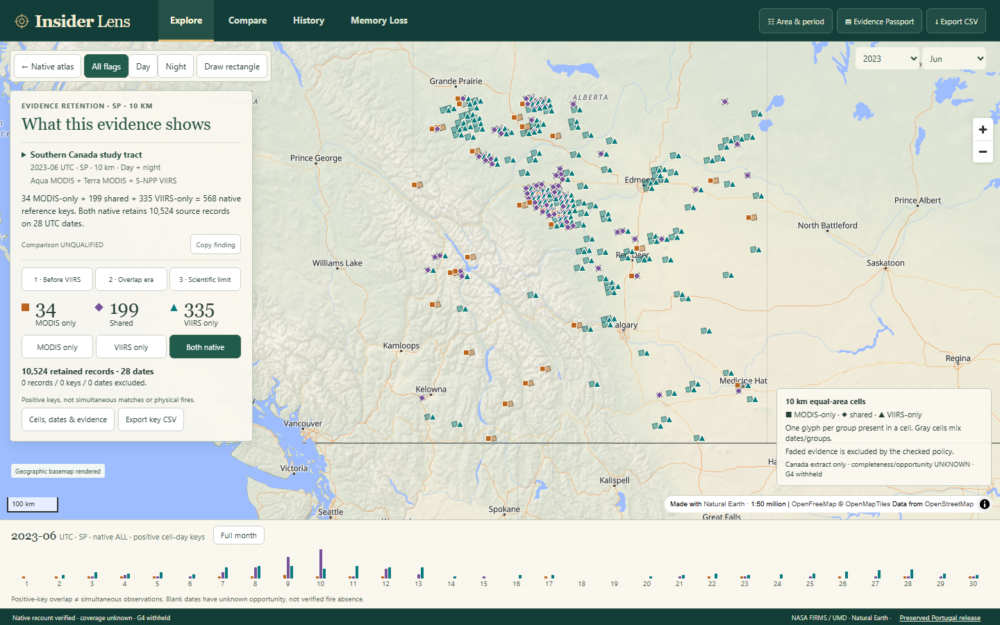
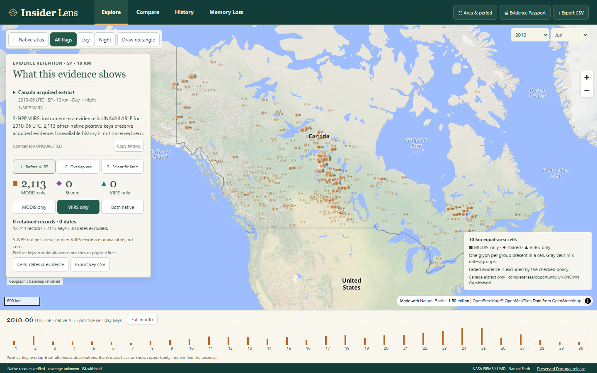

# Insider Lens

**Preserving satellite fire history across MODIS and VIIRS generations.**

NASA Space Apps Challenge 2026 · Team **Insider Lens** · Cairo, Egypt  
Challenge: **Harmonization of MODIS and VIIRS Hot Spots**

[**Open the live application →**](https://insider-lens.pages.dev/?region=canada&view=retention) · [Public source](https://github.com/bavlybibo/Insider-Lens) · [Scientific method](docs/SCIENTIFIC_SCOPE.md)



> **Release status:** the complete static application is live on **[Cloudflare Pages](https://insider-lens.pages.dev/?region=canada&view=retention)**. All 798 deployed resources were anonymously verified by HTTP status, size and SHA-256; real Canada policies, history, cell/date evidence, exports and Scientific Bridge were tested in a fresh desktop browser. Scientific data and results are unchanged. The [earlier demo](https://emberguard-evidence-retention.musicalartichoke4.chatgpt.site/?region=canada&view=retention) remains available and was not modified. [Executed Canada route repair and production verification](reports/PAGES_CANADA_PRODUCTION_REPAIR.md).

## The problem

MODIS and VIIRS have different spatial responses, sensitivities, acquisition times and observation conditions. Comparing raw hotspot totals can confuse instrument differences with changing fire activity. Focusing only on the newer VIIRS record also discards acquired MODIS evidence from before the S-NPP era.

## Our solution

Insider Lens keeps source identity and uncertainty visible. A geographic atlas, fixed equal-area cells and UTC positive-activity calendar connect **what was reported** to exact evidence. The Evidence Retention map shows what MODIS-only, VIIRS-only and both-native policies retain or exclude. An Evidence Passport exposes source/processing lineage; CSV exports reproduce the same committed cell/date/filter selection. Explore, Compare, History, Memory Loss, Heat Atlas and an experimental Scientific Bridge remain available.

The desktop result explains its current area, period, selected sources, SP/NRT status and native Day/Night flags. “Copy finding” includes the actual conclusion, limitation, release identity and source hashes. Unavailable eras, unacquired products and unknown observation support remain distinct.

## Verified result: Southern Canada, June 2023

Standard Processing; all native acquisition flags; study tract 120–110°W, 49–55°N; original 10 km equal-area grid:

| Reported-positive cell-day group | Keys |
|---|---:|
| MODIS only | 34 |
| Shared | 199 |
| VIIRS only | 335 |
| **Union** | **568** |

MODIS-only policy excludes 335 positive keys present in the acquired VIIRS record; VIIRS-only excludes 34 keys present in MODIS. Both-native retains 10,524 source records: Aqua 990 + Terra 1,149 + S-NPP 8,385. June 2010 preserves 12,744 acquired MODIS records from before the S-NPP FIRMS era.

These are **positive spatial-cell/UTC-day keys**, not 568 individual fires. Shared keys do not establish simultaneous valid observation opportunities; exclusive keys are not confirmed missed fires. **Calibrated continuity remains unresolved: G4 ADJUSTMENT_WITHHELD.**

## Visual demonstration

Select a geographic cell and inspect the exact source records, UTC dates and retained/excluded evidence:


Before VIIRS: older acquired evidence remains visible while unavailable instrument history stays explicitly unavailable:



All images are genuine desktop captures from this repository using NASA observations. Map attribution is retained. No mockup or synthetic observations are displayed.

## Scientific method

- Aqua MODIS, Terra MODIS and S-NPP VIIRS remain separate; SP and NRT are never pooled.
- Fixed 10 km WGS84 ellipsoidal Lambert azimuthal equal-area cells; native acquisition D/N flags and UTC grouping. Research rectangles select cell centers, W/S included and E/N excluded.
- Exact set difference/intersection/union on reported-positive keys. MODIS occupancy uses an Aqua/Terra union, not addition of overlapping keys.
- Python production processing and separate original-data parsing/projection/counting oracles; immutable archive/member hashes and versioned browser artifacts.
- Unknown coverage and processing-vintage limits are exposed. Existing scientific releases, holdouts and bridge decisions are preserved.

[Scope and source hashes](docs/SCIENTIFIC_SCOPE.md) · [Reproduction boundaries](docs/REPRODUCIBILITY.md) · [Release audit and executed validation](reports/FINAL_INSIDER_LENS_RELEASE_AUDIT.md)

## Run and reproduce

### Complete static release / Cloudflare Pages

```sh
npm ci
npm run build:cloudflare
npm run preview
```

Use **Node.js 22**, production branch **main**, build command **`npm run build:cloudflare`**, output **`dist`**, and **`SKIP_DEPENDENCY_INSTALL=1`**. With that variable, this command installs only lockfile-pinned JavaScript dependencies. It restores three allowlisted, already public immutable receipts over verified HTTPS, checks their exact sizes and SHA-256 values, verifies every public runtime asset and catalog dependency, then builds and verifies the complete static output. A download, integrity or dependency failure stops the build. Python, Earthdata credentials, NASA ZIP/HDF files and research databases are not needed for deployment or browser operation.

[Deployment and integrity checks](docs/CLOUDFLARE_PAGES.md) · [Per-resource production verification](reports/pages-repair/production-resources.tsv).

Node 22+ and Python 3.12+ recommended. The lockfiles pin tested dependencies.

```sh
python -m venv .venv
# Activate .venv for your shell, then:
python -m pip install -r requirements.lock.txt
python scripts/restore-public-artifacts.py
npm ci
npm run dev
```

Open `/?region=canada&view=retention` at the printed URL. Three original public provenance receipts are restored explicitly by URL, byte size and SHA-256 because their immutable bytes contain acquisition-machine paths. All other lightweight runtime artifacts are committed. No credential, raw archive or local Python service is required by the browser.

```sh
npm run build
npx playwright install chromium
npx playwright test --config playwright.public.config.ts
python -m unittest discover -s science -p test_science.py -v
python scripts/verify-public-release.py
```

The public-clone browser profile excludes one non-runtime historical-audit binding test whose private receipt is not published. Synthetic Python checks and the 12-case production replay do **not** replace the original-data oracle. A complete raw/L2 research replay requires separately acquired originals, disk indexes and historical receipts; see the [explicit rebuild tiers](docs/REPRODUCIBILITY.md). No simulated substitute is provided.

## Validation and scientific limits

Executed results for this release are recorded in [the release audit](reports/FINAL_INSIDER_LENS_RELEASE_AUDIT.md) and [validation notes](docs/VALIDATION.md), including exact commands, current counts, clean-clone scope, desktop screenshots and measured performance. Historical counts are labeled by execution rather than presented as a new run.

Observation support/completeness remains unknown. No normalized trend, seasonal anomaly, missed-fire estimate, physical-fire count or calibrated harmonization is released. Missing/unacquired data and absent selected rows are never confirmed fire-free periods. Source collection labels and row version codes do not certify uniform monthly processing vintage. G4 remains **ADJUSTMENT_WITHHELD**.

## NASA data, geography and rights

**NASA observations:** NASA FIRMS / University of Maryland, MODIS C6.1 requests 844805/845605 and S-NPP VIIRS 375 m C2 requests 844806/845606. Canada deliveries contain JSON; the Portugal diagnostic contains CSV. [FIRMS archive and citation](https://firms.modaps.eosdis.nasa.gov/download/Readme.txt) · [NASA Earthdata](https://www.earthdata.nasa.gov/data/tools/firms).

**Geographic context:** Natural Earth public-domain coarse geography; OpenFreeMap, OpenMapTiles and OpenStreetMap detailed context with map attribution retained. No bulk provider tiles or NRCan perimeter dataset is redistributed.

**Method, research and software:** [Scientific scope](docs/SCIENTIFIC_SCOPE.md), [source/rules references](public/submission/SOURCES_AND_RULES.md), [147-package inventory and copied third-party notices](public/submission/THIRD_PARTY_SOFTWARE.json). Original-content license selection remains a team decision; no license grant is invented. See [license status](LICENSE_STATUS.md). NASA data use does not imply NASA endorsement.

## Team and AI disclosure

**Insider Lens — Cairo, Egypt.** Historical internal codename **EmberGuard** is retained in source contracts, release IDs and historical reports. No individual contributions are invented.

OpenAI Codex assisted software, research, text, separate oracle implementations and tests. NASA observations were acquired, not AI-generated. Separate software recounts in one AI-assisted workflow are not independent human scientific review. [Full disclosure](public/submission/AI_DISCLOSURE.json) · [Copy-ready NASA submission](docs/NASA_SUBMISSION.md).
