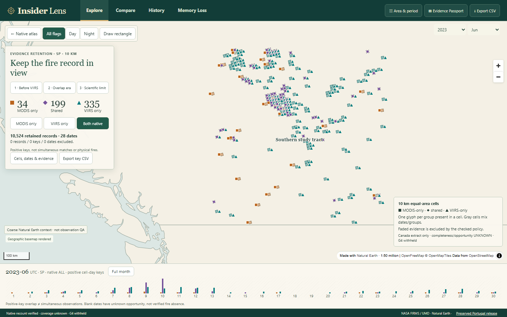
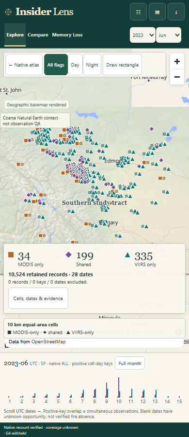

# Insider Lens

**Historical fire evidence that survives a sensor switch.**  
Team **Insider Lens** · NASA Space Apps Challenge 2026 · Harmonization of MODIS and VIIRS Hot Spots

[](https://emberguard-evidence-retention.musicalartichoke4.chatgpt.site/?region=canada&view=retention) [](docs/SCIENTIFIC_SCOPE.md)

[**Open the live Evidence Retention map →**](https://emberguard-evidence-retention.musicalartichoke4.chatgpt.site/?region=canada&view=retention)



<details><summary>Mobile application</summary>



</details>

## The problem and the working solution

A sensor transition can erase access to earlier observations or create misleading comparisons between instruments. Insider Lens preserves source identity and makes historical evidence retention measurable. It implements a geographic atlas, native source comparison, UTC historical calendar, Memory Loss investigation, Evidence Passport, exact scientific CSV exports and a supplementary Scientific Bridge laboratory.

Southern Canada (120–110°W, 49–55°N), June 2023 Standard Processing:

| Positive cell-day group | Keys |
|---|---:|
| MODIS only | 34 |
| Shared | 199 |
| VIIRS only | 335 |
| **Union** | **568** |

These are independently reconciled **reported-positive fixed spatial-cell/UTC-day keys**, not 568 fires or calibrated simultaneous observation opportunities. The original 10 km ellipsoidal equal-area grid is unchanged. Aqua 990 + Terra 1,149 + S-NPP VIIRS 8,385 = 10,524 reported source records. MODIS occupancy uses an Aqua/Terra union, not addition. June 2010 retains 12,744 acquired MODIS records from before the S-NPP FIRMS era.

**Calibrated MODIS–VIIRS continuity is unresolved. G4: ADJUSTMENT_WITHHELD.** No missed-fire count, cloud-free opportunity, observed-zero day, anomaly or source-normalized trend is inferred.

## Run the actual application

Node 22+ and Python 3.12+ are recommended. `package-lock.json` and `requirements.lock.txt` pin the tested dependencies.

```sh
python scripts/restore-public-artifacts.py
npm ci
npm run dev
```

Open the printed local URL, then `/?region=canada&view=retention`. The restore command downloads three small, SHA-256-checked **existing public provenance artifacts** omitted from Git because their immutable original bytes contain acquisition-machine paths. It needs no credential. All remaining lightweight runtime artifacts are committed. No raw NASA archive, SQLite database, secret or simulated substitute is required to run the demo.

```sh
npm run build
npx playwright install chromium
npx playwright test --config playwright.public.config.ts
python -m venv .venv
# Activate .venv for your shell, then:
python -m pip install -r requirements.lock.txt
python -m unittest discover -s science -p test_science.py -v
python scripts/verify-public-release.py
```

The synthetic known-answer suite tests parser/projection/duplicates; it does not replace the real-data oracle. The browser suite checks exact published evidence, policies, map/calendar/export agreement, faults and mobile behavior. [Reproduction tiers and original-data rebuild](docs/REPRODUCIBILITY.md) distinguish portable checks from the complete archive/L2 audit, which requires separately acquired source files and preserved local receipts. **The public clone does not independently reparse the full 8.36 million original records.**

## Science and provenance

- NASA FIRMS / University of Maryland: MODIS C6.1 requests 844805 and 845605; S-NPP VIIRS 375 m C2 requests 844806 and 845606. Canada delivery contains JSON records; the Portugal diagnostic contains CSV.
- Source archives are immutable and SHA-256 bound. Python production code and separate parsing/projection/counting oracles remain in `science/`. Browser results load hash-verified source/processing/month artifacts.
- Aqua, Terra and S-NPP; Standard Processing and NRT; native acquisition D/N flags remain distinct. Unknown observation support never becomes zero.
- Historical internal codename **EmberGuard** remains in release IDs, contracts and historical evidence for reproducibility.

[Scientific scope, hashes and limitations](docs/SCIENTIFIC_SCOPE.md) · [Reproduction](docs/REPRODUCIBILITY.md) · [Submission fields and demo](docs/NASA_SUBMISSION.md) · [Attribution and AI disclosure](public/submission/README.md)

## Rights and disclosure

Credit **NASA FIRMS / UMD** for source observations; NASA does not endorse this project. Geographic context: Natural Earth (public domain); OpenFreeMap / OpenMapTiles / OpenStreetMap attribution remains on the live map. No bulk provider tiles or NRCan perimeter dataset is redistributed. [Third-party notices](public/submission/THIRD_PARTY_SOFTWARE.json) include copied installed license texts.

No project-wide open-source license has been invented or granted on the team's behalf. See [license status](LICENSE_STATUS.md); source visibility does not itself grant reuse rights. Final OSI license selection, competition eligibility/reuse and official submission remain team actions.

OpenAI Codex assisted code, research, text and tests; NASA observations were not AI-generated. [Full AI disclosure](public/submission/AI_DISCLOSURE.json). Separate software oracles within one AI-assisted workflow are not independent human scientific review.
