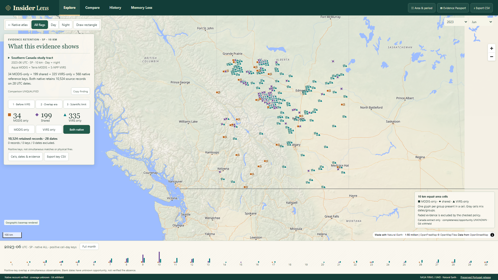
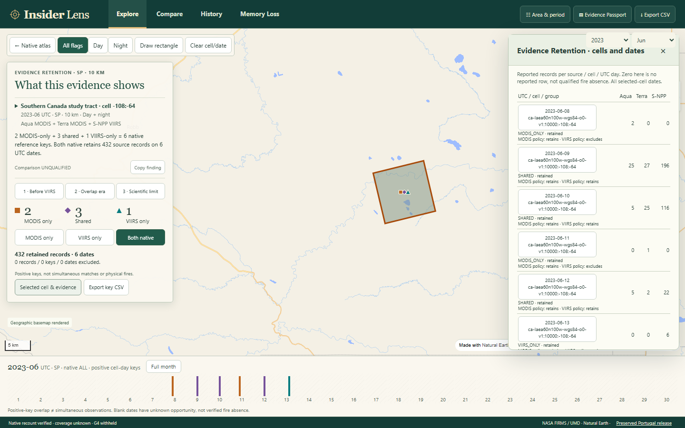

<div align="center">

# INSIDER LENS

*Preserving fire evidence across satellite generations.*

NASA Space Apps Challenge 2026 — Cairo, Egypt<br>
**Challenge:** Harmonization of MODIS and VIIRS Hot Spots

[**Live Investigation**](https://insider-lens.pages.dev/?region=canada&view=retention) · [Scientific Method](docs/SCIENTIFIC_SCOPE.md) · [Reproducibility](#run-and-reproduce) · [Evidence & Validation](#validation)

</div>

[](reports/pages-repair/screenshots/retention-1920.png)

*The real Pages application: Southern Canada, June 2023. Select sources, explore the map and follow reported evidence through UTC dates. Open the image for full-resolution detail.*

## Why satellite history is easy to misread

MODIS provides a longer historical record of thermal anomalies. S-NPP VIIRS adds newer observations with different sensitivity and finer nominal spatial resolution. A change in raw hotspot totals can reflect those instrument differences as well as changing activity; the totals alone cannot separate the two.

Using VIIRS alone can also exclude acquired MODIS evidence from before its operational era. That unavailable VIIRS history is not an observation of zero fire activity.

**Insider Lens makes the consequences of a source switch inspectable.** It preserves native observations, shows which geographic cells and UTC dates each source retains, and connects every selected result to its provenance and export. Calibrated cross-sensor harmonization remains withheld.

## The verified comparison

**Southern Canada research tract · June 2023 UTC · Standard Processing · All native acquisition flags · Fixed 10 km equal-area cells**

Within 120–110°W, 49–55°N, the acquired record partitions into:

| MODIS-only positive keys | Shared positive keys | VIIRS-only positive keys | Distinct union |
| :---: | :---: | :---: | :---: |
| **34** | **199** | **335** | **568** |

Both-native selection retains **10,524 source records**: 990 Aqua MODIS + 1,149 Terra MODIS + 8,385 S-NPP VIIRS.

- **MODIS-only policy:** retains 233 keys and 2,139 records; excludes the **335** VIIRS-exclusive positive keys.
- **VIIRS-only policy:** retains 534 keys and 8,385 records; excludes the **34** MODIS-exclusive positive keys.

> A key is one fixed spatial cell and one UTC day with reported positive evidence. Shared keys mean reported positives in the same cell/day, **not qualified simultaneous observations**. These are not individual physical wildfire counts, detection rates or confirmed missed fires.

[Inspect the comparison live](https://insider-lens.pages.dev/?region=canada&view=retention) · [Scientific scope and source identities](docs/SCIENTIFIC_SCOPE.md) · [Independent partition acceptance](public/data/phase12/INDEPENDENT_PARTITION.json)

## Follow the evidence

### From a geographic cell to exact source records

Select a cell on the map, inspect its UTC dates, and switch source policies without changing the underlying evidence. The example below contains **432 source records across six positive dates**: 37 Aqua, 55 Terra and 340 S-NPP records.

[](docs/assets/scientific-evidence-detail.png)

*Selected-cell ledger from the desktop release audit. Later Pages repairs changed routing and error recovery; these values and investigation controls are unchanged. This panel shows cells and dates, not the Evidence Passport.*

Open **Evidence Passport** for source lineage, hashes and scientific limitations. Export CSV to retain the exact selected sources, cell, dates and acquisition flags; the export carries provenance and withheld-adjustment status.

### Preserve the earlier record

June 2010 contains **12,744 acquired MODIS records across 2,113 positive cell-day keys and 30 UTC dates**. S-NPP VIIRS is not yet in the available instrument era.

[](docs/assets/historical-evidence-before-viirs.png)

*Desktop release-audit capture, with VIIRS-only selected. Its zero retained records reflects the selected policy, not fire-free conditions: S-NPP history is unavailable and 12,744 MODIS records are excluded. The later Pages release preserves this record and era treatment.*

## What we built

| Capability | What it makes inspectable |
| --- | --- |
| **Source-aware historical atlas** | Real NASA FIRMS observations; Aqua MODIS, Terra MODIS and S-NPP VIIRS identities remain separate. Standard Processing and NRT are not pooled. |
| **Evidence Retention map** | MODIS-only, VIIRS-only and both-native policies expose retained and excluded positive keys and source records. |
| **UTC calendar and geographic selection** | Fixed WGS84 equal-area cells, native Day/Night flags, cell/date inspection and explicit unavailable-era or unacquired-product states. |
| **Evidence Passport and CSV** | Hash-bound source provenance, processing limits and reproducible exports of the committed selection. |
| **Independent numerical reconciliation** | Separate original-data parsing/projection/counting checks and exact set-partition acceptance receipts. |
| **Experimental Scientific Bridge** | A bounded Level-2 investigation with explicit qualification restrictions. Its 16 candidates remain `UNKNOWN_SUPPORT`; no calibration is released. |

## Scientific Integrity

**Verified:** source-specific reported-positive evidence; exact set partitions; source, UTC and grid provenance; retained/excluded record identities; and independent numerical reconciliation.

**Unresolved:** qualified common observation opportunity, calibrated cross-sensor continuity, observation-normalized trends and scientifically validated wildfire anomalies. Absent rows, unknown coverage and unavailable eras cannot establish fire absence. Production-vintage and upstream-processing limits remain explicit.

**`G4 = ADJUSTMENT_WITHHELD`**

The fixed 10 km grid uses WGS84 ellipsoidal Lambert azimuthal equal-area projection, centered at 60°N, 100°W. Geographic selection rules and processing limits are documented in the method.

[Method and scientific limits](docs/SCIENTIFIC_SCOPE.md) · [Research and source references](public/submission/SOURCES_AND_RULES.md)

## Architecture

NASA FIRMS archives feed **Python + PROJ** processing and separate analytical/original-data checks. Accepted results become versioned public scientific artifacts and independent acceptance receipts, bound by **SHA-256**.

The browser uses **React · TypeScript · Vite · MapLibre GL** to connect those artifacts to the map, calendar, Evidence Passport and CSV. **Cloudflare Pages serves a static application**; browser operation requires no Python backend, Earthdata authentication or raw research archive.

## Run and reproduce

For a clean public clone, use **Node.js 22**, Git and an internet connection:

```sh
git clone https://github.com/bavlybibo/Insider-Lens.git
cd Insider-Lens
npm ci
npm run build:cloudflare
npm run preview
```

Open `/?region=canada&view=retention` at the preview address printed by Vite. The build restores three pinned public provenance receipts over verified HTTPS, checks their byte lengths and SHA-256 values, verifies runtime dependencies and compiles the static site. Missing or incorrect evidence stops the build; no substitute observations are supplied.

**Public demo build ≠ full research reproduction.** Python is not needed for the static build. Rebuilding the raw-data oracles requires the separately preserved original NASA archives, disk indexes, Level-2 inputs and historical receipts. Portable hash checks and a frozen-case replay do not replace a fresh original-data recount.

[Full research reproduction tiers](docs/REPRODUCIBILITY.md) · [Static build and integrity checks](docs/CLOUDFLARE_PAGES.md)

## Validation

Recorded executions on **14 November 2026** are distinct checks, not one combined test total. They are existing release evidence, not new research runs for this README.

| Evidence layer | Recorded result | Receipt |
| --- | --- | --- |
| Full research workspace | **72 scientific tests passed** in the final desktop release audit; original inputs required | [Research audit](reports/FINAL_INSIDER_LENS_RELEASE_AUDIT.md#science-and-executed-checks) |
| Portable scientific preservation | **771 file hashes verified; 12 frozen partition cases replayed** | [Preservation and local checks](reports/pages-repair/local-tests.json) |
| Existing desktop browser/contracts | **59 passed** during the Pages routing repair | [Executed suite](reports/pages-repair/local-tests.json) |
| Live Pages investigation | **5 routing/failure tests + 6 scientific journeys passed** in that repair execution | [Live test receipt](reports/pages-repair/live-tests.json) |
| Deployment checks | Production static build and **5 deployment unit tests passed** | [Production repair report](reports/PAGES_CANADA_PRODUCTION_REPAIR.md) |
| Remote resource integrity | **798 deployed resources** verified by HTTP status, exact bytes and SHA-256 | [Per-resource verification](reports/pages-repair/production-resources.tsv) |

The later release added a sixth missing-JSON regression: HTML cannot pass scientific verification. The [Pages repair and completion report](reports/PAGES_CANADA_PRODUCTION_REPAIR.md) distinguishes executions, source commits and measured performance endpoints.

## Data, attribution and rights

**NASA observations.** NASA FIRMS / LANCE / University of Maryland: MODIS Collection 6.1 and S-NPP VIIRS 375 m Collection 2. Canada archive requests **845605 / 845606** support the historical investigation; **844805 / 844806** support the preserved Portugal diagnostic. Source archive, member and runtime hashes remain attached to the scientific evidence. [FIRMS archive description, citation and disclaimer](https://firms.modaps.eosdis.nasa.gov/download/Readme.txt).

**Geographic context.** Natural Earth supplies bundled public-domain coarse geography. OpenFreeMap, OpenMapTiles and OpenStreetMap supply credited detailed context. Geographic basemaps are not observation masks or fire-validation data; attribution remains visible in every screenshot.

[Source acknowledgments and use conditions](public/submission/SOURCES_AND_RULES.md) · [Third-party software and notices](public/submission/THIRD_PARTY_SOFTWARE.json) · [Project license status](LICENSE_STATUS.md)

No project-wide open-source license grant is asserted. Original-content license status is recorded separately from NASA data and third-party software rights. This project does not imply NASA endorsement or scientific approval.

## Team and AI assistance

**Team Insider Lens · Cairo, Egypt.** The historical codename **EmberGuard** remains in scientific identifiers and historical records to preserve reproducibility.

OpenAI Codex assisted software, research, documentation, separate oracle implementations and testing. NASA observations were acquired, not AI-generated. No independent human scientific review is claimed. [Full AI assistance disclosure](public/submission/AI_DISCLOSURE.json).
